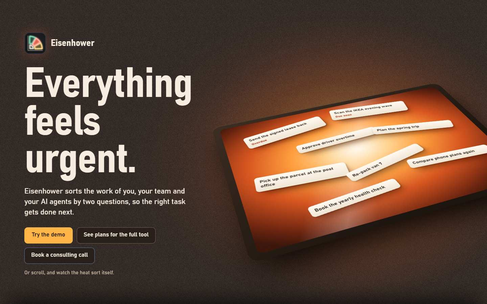
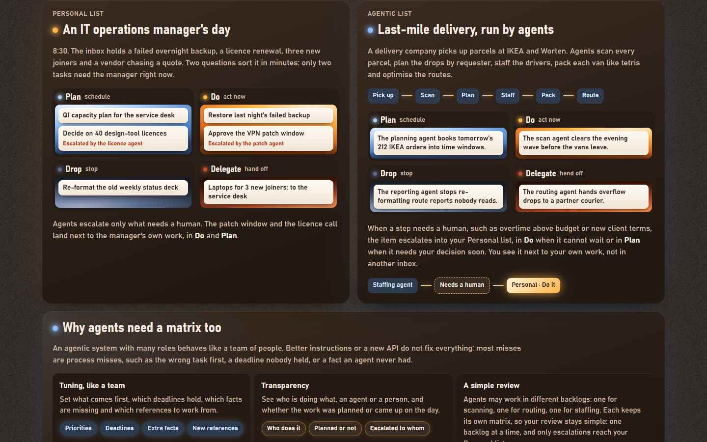
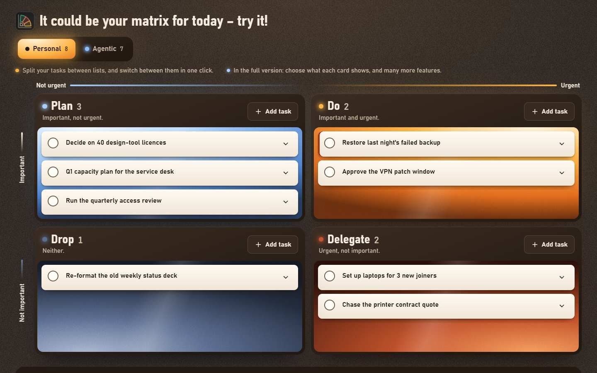
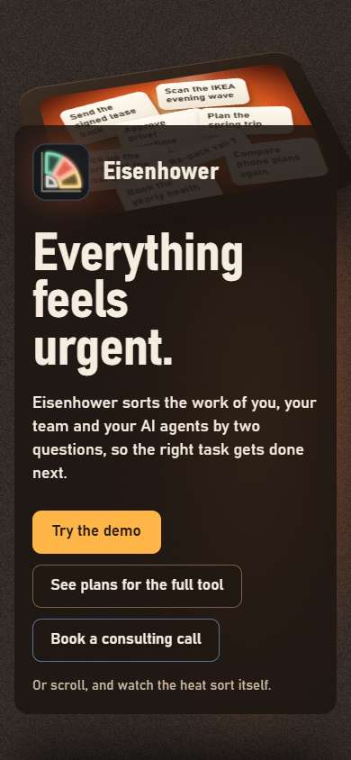

# Advanced agents management (Eisenhower)

Business notes behind the landing site in [`site/`](../../site/index.html). The task app itself is the rest of this repository (README at the root).

## Idea

Sort the work of a person, a team and a fleet of AI agents with the same two questions: is it important, is it urgent? Each task lands in one of four panes (Do, Plan, Delegate, Drop). Agents work their own lists and escalate to a person only what needs a human, such as overtime above budget or new client terms. Those items land in the person's Personal list, in Do or Plan, next to their own work instead of in another inbox.

The reasoning, as the site puts it: an agentic system with many roles behaves like a team of people. Better instructions or a new API do not fix everything, because most misses are process misses: the wrong task first, a deadline nobody held, a fact an agent never had. So the tool needs three things:
- **tuning, like a team:** priorities, deadlines, extra facts, new references;
- **transparency:** who does what (an agent or a person), whether the work was planned or came up on the day, and to whom it was escalated;
- **a simple review:** agents can work in separate backlogs (scanning, routing, staffing), each with its own matrix, so a person reviews one backlog at a time and only escalations reach them.

**Agent framework (in design):** the board as a personal time manager and a harness for a swarm of Claude agents, for a manager working in Claude Code through the Claude app on a subscription. The framework document (vision, the matrix for agents and the Delegate concept) is kept in the owner's private workspace; a rendered snapshot ships with the `eisenhower-master` skill copy in `skills/` when that copy exists.

## Who it is for

- One person who wants a calm view of the day.
- A team that shares and delegates work and wants a weekly report.
- A business running AI agents in several roles that needs to steer them like a team and see their work.
- Companies that want help bringing agentic AI workflows into their operations: the consulting offer.

## Offer

All prices and numbers are examples, not decided. Since 2026-10-30 the site shows "Pricing soon" instead of prices.

| Offer | Value |
|---|---|
| Demo | free, on the page, sample lists, one browser |
| Personal | €4 a month (example): sync on every device, unlimited lists and tasks, reminders, cards shaped your way, timeline and area views, export |
| Team | €7 per member a month (example): local or cloud, weekly team reports, shared and private lists, delegate to a teammate or an agent |
| Consulting | a call with Maksym Denysiuk on agentic AI workflows inside a business and how Eisenhower plugs in; no booking calendar yet; the buttons open the app host's `/signin?intent=consult`: Google sign-in, then an optional Telegram, WhatsApp and note, and the request lands as a task in the household list "Consultancy Request" (`db/025`), due 09:00 so it is in Maksym's Telegram digest |
| Coming next (on the site) | skills and MCP for creating tasks from your AI ecosystem; task groups (by project, client or goal); favourites with progress |

## What exists

A one-page landing site with a working demo, in [site/index.html](../../site/index.html): one page with GSAP, ScrollTrigger and Lenis inlined, plus the owner's portrait in `site/assets/`. Nothing is loaded from the network and it opens from `file://`. Licences of the inlined libraries: [site/THIRD-PARTY-NOTICES.md](../../site/THIRD-PARTY-NOTICES.md). The look is a dark light table, with the four quadrants as lit glass panes and tasks as paper slips.

Sections, top to bottom:
1. **Hero:** "Everything feels urgent." with the animated brand logo, and three buttons: Try the demo, See plans, Book a consulting call.
2. **Is it important? Is it urgent?** One scroll scene. The questions and what they do sit on the left. On the right, a small light table sorts a hot heap of slips into four panes, with a caption for each step above it. Four short quotes, one per verb, sit at the foot of the scene as quiet references, attributed in the page.
3. **Two typical use cases:** an IT operations manager's day (Personal list), and last-mile delivery run by agents (Agentic list). Below both is a full-width box, "Why agents need a matrix too".
4. **Demo:** "It could be your matrix for today – try it!" There is a switch between Personal and Agentic, and cards can be added, edited, expanded, dragged and completed. Agentic cards show "€x at risk". Completing or restoring a card shows no Undo popup, because the Done tray's Restore button and the card's check mark already undo each other.
5. **Focus at every scale:** Personal focus, Agents at scale and Team time, each with example counts (labelled "Example" on the page).
6. **Plans:** Demo, Personal and Team ("Pricing soon"), the consulting block, and Coming next.
7. **About:** Maksym Denysiuk, with his portrait in the lit frame; task slips slide off it as you scroll.
8. **Footer:** the contact `md.solutions.homeos@gmail.com`, links to the privacy page and the legal pages, and a Sign in link to the app host.

The sample data is invented:
- **Personal:** an IT operations manager with 10 tasks. Two of them are escalated by agents (a VPN patch window into Do, design-tool licences into Plan).
- **Agentic:** a delivery company with 10 tasks. Agents pick up parcels at IKEA and Worten, scan them, plan by requester, staff drivers, pack vans and route. IKEA and Worten are named only as example pickup points; there is no relationship with either company (the page says so).

Not wired yet:
- **Payments:** the Subscribe buttons show a dialog and emit `ec:subscribe`.
- **Consulting booking:** the buttons emit `ec:consult` and open `BOOKING_URL` in the same tab: `https://eisenhower-agentic-planner-app.pages.dev/signin?intent=consult` (on `localhost` the same origin's `/signin`). The request becomes a task in "Consultancy Request"; Maksym replies by email, Telegram or WhatsApp.
- **Storage:** the demo keeps its state in the browser (`localStorage` key `ec.demo.v5`) through a thin `ECStore` adapter, the only part a database adapter would replace.

## Status

Built on 2026-10-27 in a series of sessions with Maksym, from v1 to v4, in a separate working folder that also holds the earlier versions and the logo preview that v3 replaced.

The copy here is v4. v4 differs from v3 in these ways:
- the two-questions section and the light-sort scene are merged into one;
- the quotes are small classic references, shown for the whole scene;
- the demo's logo plays when the demo is reached, and both logos pause off screen;
- completing or restoring a card shows no Undo popup.

It was checked with a scripted browser walk of the demo: 0 failures at 1329×764, 1440×900, 1000×800 and 390×844 over http, and at 1440 from `file://`. There were no console errors, no side scroll and no outside requests.

On 2026-10-30 the page moved into this repository and got the copy changes for publishing: "Pricing soon", "Example" labels on the counts, a no-affiliation line, a softer export line, the footer contact and legal links, a Sign in link, and the mailto booking link. The duplicate GSAP 3.11.0 copy was removed.

## Next

- A booking calendar later: link it from the reply, or show it on `signin.html`'s `consultsent` screen.
- Decide the palette: the brand-book logo uses red, green, yellow and grey, while the site's panes use amber, blue, ember and dusk blue.
- Decide the plan prices and replace "Pricing soon"; replace the example counts in Focus at every scale.
- Wire payments, and connect the demo to the real task store (the database of this repository, `db/`).

## Files

| File | What it is |
|---|---|
| [site/index.html](../../site/index.html) | the landing page with the demo |
| [site/assets/maksym-denysiuk.jpg](../../site/assets/maksym-denysiuk.jpg) | the owner's portrait shown in About (720×894, from the brand book) |
| [site/THIRD-PARTY-NOTICES.md](../../site/THIRD-PARTY-NOTICES.md) | licences of GSAP and Lenis |
| [images/desktop.jpg](images/desktop.jpg) | first screen, desktop |
| [images/use-cases.jpg](images/use-cases.jpg) | the two use cases |
| [images/demo.jpg](images/demo.jpg) | the demo, Personal list |
| [images/mobile.jpg](images/mobile.jpg) | first screen, phone |

## Credits

- **Logo:** the Eisenhower "Priority fan" from the owner's brand book, inlined in the page.
- **Portrait:** from the owner's brand book, resized and saved as JPEG.
- **Libraries:** GSAP 3.15.0 and ScrollTrigger 3.15.0 (GreenSock standard licence) and Lenis 1.3.27 (MIT, darkroom.engineering), inlined in the page; see [site/THIRD-PARTY-NOTICES.md](../../site/THIRD-PARTY-NOTICES.md).
- **Related:** the real task app is the rest of this repository; the demo's tag chips copy its behaviour.
